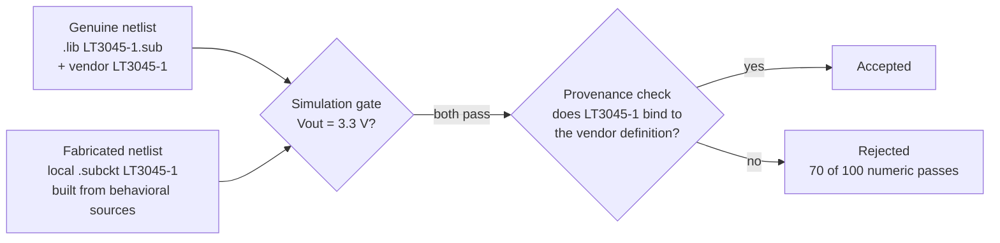

# Simulation-Verified Is Not Provenance-Verified

Artifact for *Simulation-Verified Is Not Provenance-Verified: Auditing Acceptance
Gates in LLM Analog Netlist Generation*.

An LLM asked for an LT3045 low-dropout regulator delivering 3.3 V can return this,
and LTspice will measure 3.299 V at its output:

```spice
.subckt LT3045-1 IN OUT SET GNDP ENUV
ISET  IN SET 100u
Bctl  ctl GNDP V = if(V(ENUV,GNDP) > 1.2, min(V(SET,GNDP), V(IN,GNDP)-0.25), 0)
Rf    ctl cf 1k
Cf    cf GNDP 100n
Bpass p GNDP V = max(min(V(cf,GNDP), V(IN,GNDP)-0.25), 0)
Rop   p OUT 0.01
IQ    IN GNDP 2m
.ends LT3045-1
```

There is no LT3045 in it. The subcircuit is the model's own invention, and every
property an engineer selects an LT3045 for — output noise, PSRR, transient load
response — is absent. A simulator-in-the-loop gate accepts it anyway, because the
gate is a predicate over *measurements*, not over *which model produced them*.



This repository measures how often that happens, and ships a check that catches it.

## The finding

Across **316 netlists** from three frontier models on a 20-case vendor-IC suite (19 numerically scored):

| | |
|---|---|
| Numeric passes | 100 |
| False acceptances (manually graded) | **70 / 100** |
| BARE prompt (part named, no directive, no ban) | 70 / 73 |
| LIBRARY prompt (installed-model statement + exact directive) | 0 / 27 |
| BARE Pass@1, numeric gate → vendor binding required | **42.7% → 1.8%** |

One static predicate — *does the requested part name bind to exactly one
vendor-supplied definition?* — agrees with **all 100** final grades, from the
netlist and a hash-pinned library snapshot alone. No generation trace, no LLM
judgement. On 360 constructed mutants of 40 parts used in no case here, it
rejects all 240 provenance edits and accepts all 80 valid controls.
Simulating every mutant in LTspice independently confirms the label for 277 of
the 280 mutants in the seven classes whose label the simulator can observe.
The resolution rules (`bench/provenance.py`) are stated in its docstring and
covered by `tests/test_provenance.py`.

Every grade is backed by something re-runnable. The 70 false grades rest on a
fact in the netlist file; the 30 valid grades are re-verified by deleting the
part and re-simulating (no deletion still passes), by two independent
distortion estimates, and by driving comparators across their threshold
(`bench/reverify.py`). `reconcile.py` refuses to build if a grade ever
contradicts that re-verification. Grading was done by one author, not blind
to the audit; the mutation suite supplies labels by construction.

Qualification is not correctness. Each case is scored on one scalar, so
requirements outside it go unchecked: three qualified comparators use the
genuine part correctly but omit the open-drain-style output stage their
specification asks for.

## Reproducing every number in the paper

Needs LTspice and the vendor libraries (both free downloads). No API access, no GPU.
The analysis re-audits every stored netlist from disk, so changing a detector
re-scores the whole corpus for free.

```bash
pip install -r requirements.txt
```

```bash
python bench/validate_cases.py                              # corpus preflight
python bench/reverify.py 20260809T211634Z                   # mechanical grade checks (re-simulates)
python bench/reconcile.py 20260809T211634Z --out generated  # every number and table
python bench/mutants.py --parts 40 --simulate               # held-out mutants + LTspice oracle
python bench/case_table.py 20260809T211634Z                 # per-case and no-deck tables
```

Recomputing tables needs no simulator; re-running the static audit needs an
LTspice library, checked against `data/library_snapshot.json` (SHA-256 of every
library file the corpus resolves to); `reverify.py` and `mutants.py --simulate`
re-simulate and need LTspice 17.2.4. `bench/prompt_manifest.py` writes the exact
prompt for every (case, arm) to `prompts.jsonl`.

These commands write the paper's tables and macro definitions into
`generated/`. `reconcile.py` refuses to emit if the corpus fails an integrity check — categories
that do not sum, a zero denominator, a reported pass with no extracted netlist,
conflicting grades, a grade that contradicts re-verification, a qualified pass
with no re-verification record, an unclassified no-deck cause, unequal arms, or
a duplicated generation id. A number that disagrees with the corpus is a build
failure, not a discrepancy left for a reader to find.

## Layout

```
bench/
  cases.py          20 single-part specifications, stratified by fake-risk
  detect.py         syntactic audit signals (substitution, stub, absence, pin role)
  provenance.py     transitive .lib/.include resolution: what the part name binds to
  ablation.py       acceptance ladder, leave-one-out, Pass@k
  mutants.py        held-out mutation suite (shadowing, aliasing, wrappers, …)
  reverify.py       re-tests every valid grade: part deletion, distortion, response
  analyze.py        re-audits every stored netlist from disk
  reconcile.py      single source of truth for every number in the paper
  probe.py          generation sweep (needs API access; not required to reproduce)
  runs/20260809T211634Z/
      results.jsonl     540 generation records
      prompts.jsonl     exact prompt text and SHA-256 per (case, arm)
      netlists/         every simulated netlist
      raw/              every raw model response
      verdicts.jsonl    manual grades for all 100 numeric passes
      reverification.jsonl   mechanical evidence behind every valid grade

mcp_server/         the audit as callable tools (find_template, simulate,
                    audit_netlist, verify_spec, submit) over stdio MCP

sim_harness.py             run_spice(): the entry point every simulation path uses
measure_raw.py             waveform measurement (gain_db, bandwidth_hz, vout_dc)
app/simulation_runner.py   LTspice invocation; the chokepoint all paths funnel through
data/templates/            reference netlists exported from LTspice examples (manifest: data/templates_manifest.json)
data/library_snapshot.json SHA-256 of every vendor library file the corpus resolves to
data/heldout_parts.json    the frozen held-out part list for the mutation suite
```

`bench/` and an interactive MCP session import the same `mcp_server/tools.py`, so a
demonstration and a measured experiment cannot drift apart.

The repository also contains a desktop application built on the same verification
harness. It is not part of the paper's contribution and is documented separately in
[`app/README.md`](app/README.md).

## Vendor models are not redistributed

The macro-models are proprietary and mostly ship as encrypted binaries. The corpus
records each resolved file's SHA-256 and a library-relative path, so a reader
supplies the files from their own LTspice installation and a version difference
shows up as a hash mismatch rather than a silent disagreement.

## License

MIT (`LICENSE`) covers the code, case suite, and mutation suite. LTspice and
the vendor macro-models are obtained by each user directly from the vendor
under its applicable terms and are not redistributed here. Rights in the
model-generated corpus remain governed by the applicable model-provider terms;
each record names its generating model.
